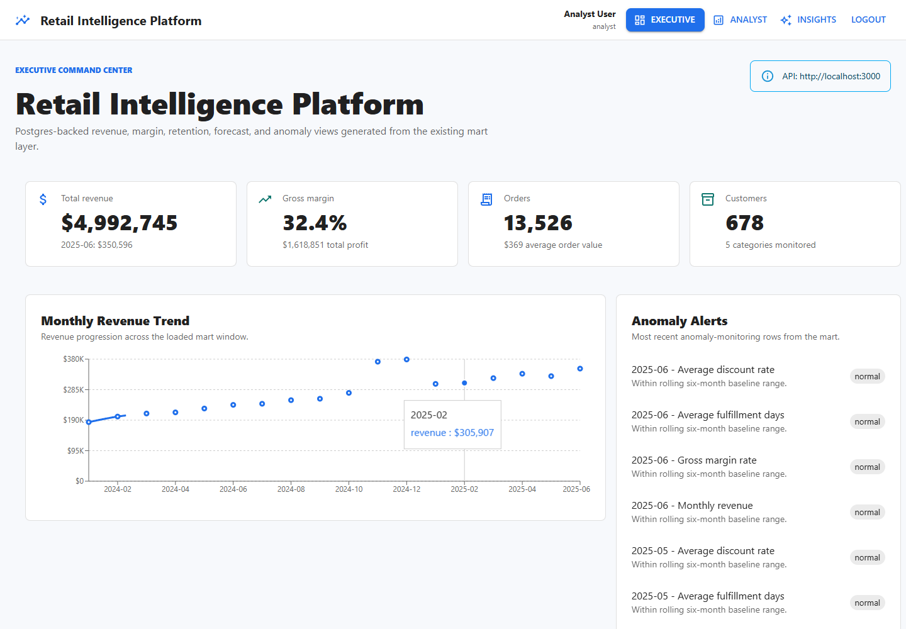
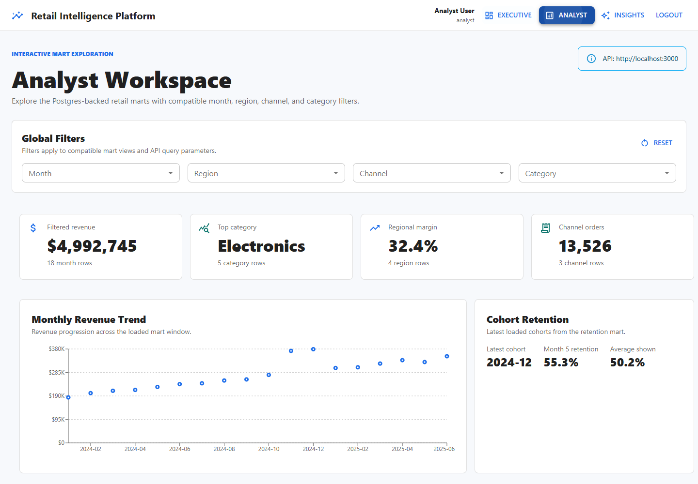
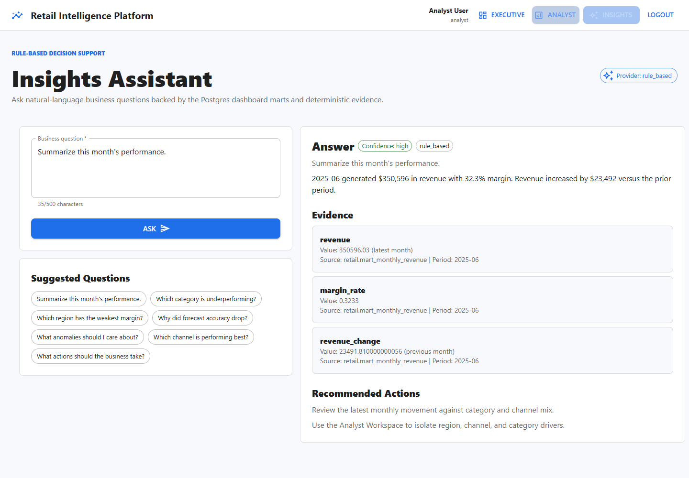
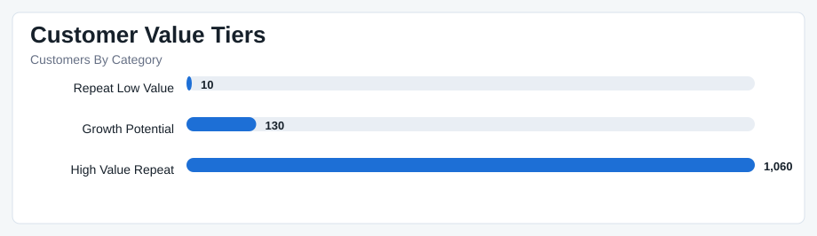
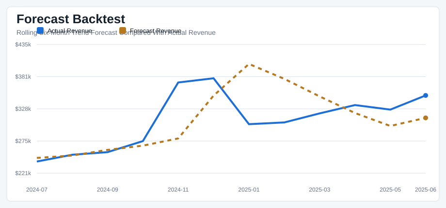
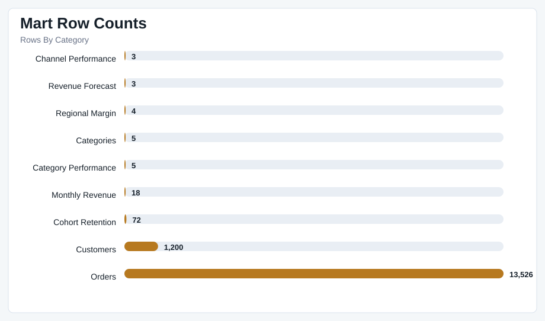

# Retail Growth Analytics

[](https://github.com/efazHossain/retail-growth-analytics/actions/workflows/ci.yml)

Retail Growth Analytics is a full-stack Retail Intelligence Platform built on a reproducible analytics-engineering workflow. It takes generated retail transactions through staging, marts, quality checks, SQL-style analysis, Python forecasting, and anomaly detection, then serves those trusted marts through a React application, Express API, FastAPI analytics service, and Postgres.

The project answers a practical business question: how can a retail business grow revenue while protecting margin?

## Platform At A Glance

- Executive Dashboard for revenue, margin, channels, regions, cohorts, forecasts, and anomalies.
- Analyst Workspace with safe filters and mart-level drilldowns.
- Insights Assistant with deterministic, evidence-backed business answers and no required LLM key.
- JWT demo authentication with role-aware API access.
- Docker Compose, health checks, smoke validation, and an AWS target architecture plan.

Read the [architecture case study](docs/case-study.md), [API reference](docs/api-reference.md), and [cloud architecture plan](docs/observability-cicd-cloud.md) for the design behind the product.

## Run The Full-Stack Platform

Prerequisites: Docker Desktop and Docker Compose. Node.js 20+ is only needed when you want to rebuild the legacy CSV pipeline. From the repository root:

```powershell
.\scripts\project.ps1 setup
```

This starts Postgres, FastAPI, the Node API, and the React frontend, loads the existing marts into Postgres, and runs health checks. Open `http://localhost:5173` and sign in with `analyst` / `AnalystDemo123!`.

Useful commands:

```powershell
.\scripts\project.ps1 start        # start or rebuild the application services
.\scripts\project.ps1 seed         # load existing marts into Postgres
.\scripts\project.ps1 smoke        # verify the end-to-end local stack
.\scripts\project.ps1 build        # validate legacy, Node, React, and FastAPI builds
.\scripts\project.ps1 status       # display container health and status
.\scripts\project.ps1 stop         # stop the local stack
```

The original static dashboard is still available through the legacy workflow below.

## Platform Preview

### Executive Dashboard



### Analyst Workspace



### Insights Assistant



## Python Analysis Preview

### Customer Value Tiers



### Forecast Backtest



### Mart Profiling



## What This Project Shows

- Analytics engineering: raw, staging, dimensional, mart, quality, and monitoring layers
- Data analytics: revenue trends, profitability, discounting, regional performance, and customer behavior
- Forecasting discipline: directional revenue forecasts plus rolling backtests with MAE, MAPE, and bias
- Monitoring: rolling anomaly alerts for revenue, margin, discounting, and fulfillment days
- Communication: findings, metric definitions, model catalog, lineage, BI handoff notes, screenshots, and project summary

## Project Structure

```text
data/
  raw/              Generated source CSVs
  staging/          Cleaned source-aligned models
  marts/            Facts, dimensions, and analysis-ready marts
  quality/          Validation check outputs
  analysis_outputs/ Reproducible SQL-style analysis extracts
  warehouse/        CSV warehouse manifest for BI/database loading
  run_history/      Pipeline run history and latest run summary
  processed/        Dashboard summary outputs and executive summary
dashboard/          Local dashboard
python/             Optional Python profiling, segmentation, and forecast scripts
scripts/            Data generation and analysis pipeline
sql/                SQL business questions and analysis queries
docs/               Documentation, findings, screenshots, lineage, and handoff notes
dbt/                dbt-style model and test scaffold for future conversion
```

## Legacy Static Dashboard

```powershell
node scripts/build.js
node dashboard/server.js
```

Then open `http://localhost:4173`.

## Platform Delivery

The platform was built iteratively while preserving the original CSV analytics pipeline and static dashboard. The detailed scope, commands, endpoint notes, and validation history live in [Implementation phases](docs/implementation-phases.md).

| Phase | Delivered outcome |
| --- | --- |
| 1–2 | Full-stack foundation and Postgres mart-serving layer |
| 3–4 | Executive Dashboard and filtered Analyst Workspace |
| 5–7 | FastAPI analytics, JWT/RBAC, and rule-based Insights Assistant |
| 8 | Health checks, structured logging, CI validation, and AWS target architecture |
| 9 | One-command local workflow, API reference, and portfolio documentation |

The full build runs:

```text
generate raw data
build staging models
build marts
validate data quality
run SQL-style analysis outputs
write dashboard summary
record run history
```

## Optional Python Layer

If you want to run the optional Python analysis layer:

```powershell
py -m venv .venv
.\.venv\Scripts\Activate.ps1
python -m pip install -e .
python python/run_all.py
```

Python outputs are written to `python/outputs/`.

## Core Outputs

- `data/marts/fact_orders.csv`
- `data/marts/dim_customers.csv`
- `data/marts/dim_categories.csv`
- `data/marts/mart_monthly_revenue.csv`
- `data/marts/mart_channel_performance.csv`
- `data/marts/mart_regional_margin.csv`
- `data/marts/mart_category_performance.csv`
- `data/marts/mart_cohort_retention.csv`
- `data/marts/mart_revenue_forecast.csv`
- `data/marts/mart_forecast_backtest.csv`
- `data/marts/mart_forecast_accuracy.csv`
- `data/marts/mart_anomaly_alerts.csv`
- `data/analysis_outputs/`
- `data/run_history/pipeline_runs.csv`
- `data/processed/summary.json`

## Documentation

- [Implementation phases](docs/implementation-phases.md)
- [Architecture case study](docs/case-study.md)
- [API reference](docs/api-reference.md)
- [Project summary](docs/project-summary.md)
- [Data model](docs/data-model.md)
- [Model catalog](docs/model-catalog.md)
- [Data dictionary](docs/data-dictionary.md)
- [Lineage](docs/lineage.md)
- [Metrics definition](docs/metrics-definition.md)
- [Data quality](docs/data-quality.md)
- [Anomaly detection](docs/anomaly-detection.md)
- [Analytics service](docs/analytics-service.md)
- [Security and RBAC](docs/security.md)
- [AI Insights](docs/ai-insights.md)
- [Observability, CI/CD, and Cloud Architecture](docs/observability-cicd-cloud.md)
- [Orchestration](docs/orchestration.md)
- [Analytics questions](docs/analytics-questions.md)
- [Findings](docs/findings.md)
- [BI handoff](docs/bi-handoff.md)
- [Dashboard screenshots](docs/dashboard-screenshots.md)
- [Python workflow](docs/python-workflow.md)
- [Python analysis report](docs/python-analysis-report.md)
- [Project log](docs/project-log.md)

## Dashboard

The local dashboard includes:

- KPI cards for revenue, profit, average order value, and gross margin
- monthly revenue trend
- category performance
- channel mix
- regional margin
- cohort retention
- pipeline health
- revenue forecast
- forecast accuracy
- anomaly alerts

## Next Improvements

- Add notebook visuals from the Python layer.
- Connect the mart CSVs to Power BI or Tableau.
- Convert the dbt-style scaffold into a working dbt project.
- Add anomaly trend visuals to the dashboard.
- Add richer orchestration metadata for runtime duration and row-level diffs.
