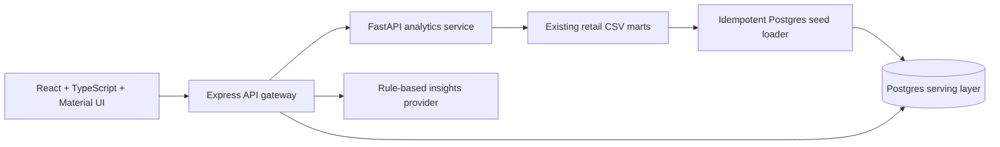

# Retail Intelligence Platform: Architecture Case Study

## The Problem

Retail Growth Analytics began as a reproducible analytics-engineering project: synthetic transactions move through CSV-based staging, marts, validation, forecasting, anomaly detection, and a static dashboard. The next challenge was to make those trusted marts usable as a secure, interactive product without replacing the original pipeline.

The resulting Retail Intelligence Platform turns those marts into a local, cloud-ready full-stack application. It supports executives who need a fast performance view and analysts who need filtered drilldowns, while keeping the data-generation workflow visible and repeatable.

## What Was Built

- React and Material UI provide an Executive Dashboard, an Analyst Workspace, and an Insights Assistant.
- Express owns API validation, JWT-based authentication, role checks, Postgres access, service proxying, and consistent error handling.
- FastAPI provides focused calculations over the existing marts: forecast accuracy, anomalies, KPI summaries, trends, and business summaries.
- Postgres is a deliberately simple serving layer with clear mart-shaped tables, seeded from the repository’s existing CSV output.
- Docker Compose runs the four local services; GitHub Actions validates the legacy pipeline, builds, and Python imports.

## Architecture Decisions

| Decision | Why it fits the MVP | Tradeoff |
| --- | --- | --- |
| Preserve CSV marts as the source pipeline | Protects the original data workflow and makes the transformation lineage easy to inspect. | Marts are loaded into Postgres rather than transformed in-place. |
| Use a Node API gateway | Gives the frontend one secure entry point for Postgres, FastAPI, auth, and insights. | Adds a small proxy hop for analytics requests. |
| Keep FastAPI CSV-first | Reuses existing Python calculations and avoids duplicating logic prematurely. | Python calculations do not yet query Postgres directly. |
| Use deterministic insights first | Produces evidence-backed, no-cost responses with predictable behavior. | It is intentionally narrower than a general LLM assistant. |
| Docker Compose before cloud deployment | Makes the complete portfolio project reproducible on a developer machine. | AWS is documented as a target design, not a deployed environment. |

## Security and Operations

The API uses request validation, JWT access tokens, role checks, Helmet, CORS configuration, login rate limiting, structured request logging, and safe error responses. Public health routes are intentionally narrow; dashboard, analytics, and insights routes require authentication.

Every container has a health check. The API supplies a dependency-aware status route, while `scripts/smoke-health.ps1` verifies the full local request path after startup. The cloud architecture plan extends the same boundaries to ECS/Fargate, RDS, S3, CloudWatch, an Application Load Balancer, and managed secrets.

## Reviewer Walkthrough

1. Run `.\scripts\project.ps1 setup` from the repository root.
2. Open `http://localhost:5173` and sign in with the local `analyst` demo account.
3. Review the Executive Dashboard for top-line performance, forecast, and anomaly views.
4. Move to Analyst Workspace and apply category, region, channel, or month filters.
5. Ask a supported question in Insights Assistant to see evidence and suggested actions.
6. Inspect [the API reference](api-reference.md), [security notes](security.md), and [cloud target architecture](observability-cicd-cloud.md) for the implementation details behind the UI.

## What Comes Next

- Replace demo users with a managed identity provider and secure token storage strategy.
- Add integration tests against a disposable Postgres database.
- Schedule mart loading through an event-driven task and retain mart artifacts in S3.
- Add an optional external LLM provider behind the current insights-provider interface.
- Convert the AWS target design into reviewed Terraform modules after deployment requirements are chosen.